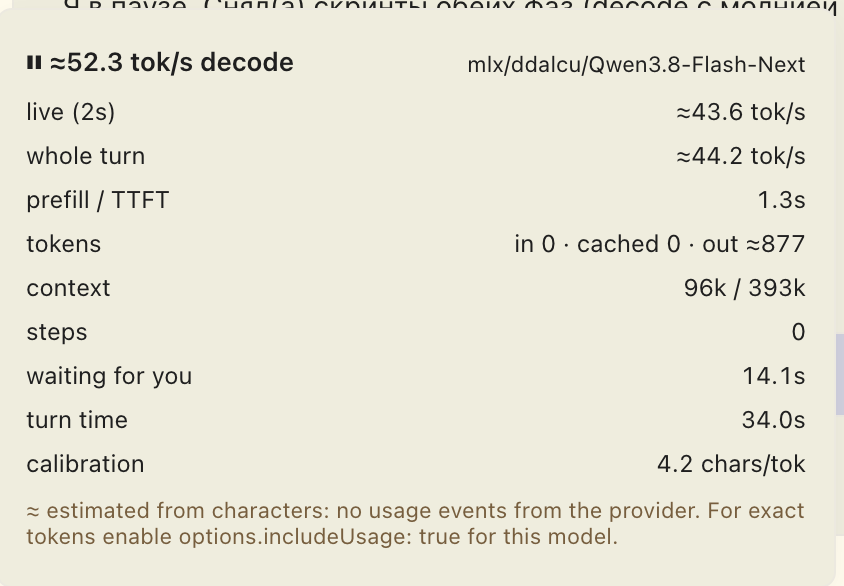
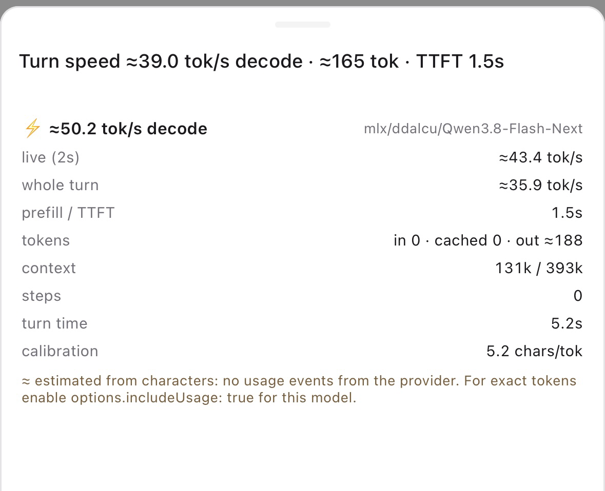

# turn-speed — live token-rate meter for Paseo agents

This fork of [Drenalol/paseo-turn-speed](https://github.com/Drenalol/paseo-turn-speed)
is based on upstream commit `9604c57e9998c01894214412d22dbedc750db5cb`. Its composer
toolbar control shows only the numeric rate (or a dash when unavailable), without
an icon, estimate marker, units, or status suffix. Tap it for the full breakdown.
The control matches the composer to an agent by its draft and settings; it retains
the match when a sent draft is cleared. Identical composers can be ambiguous.
Numbers measured from real provider usage are exact; before the first usage event
they are character estimates, identified in the accessible title and details. For
reasoning models whose provider subtracts thinking from the reported output
(measured on OpenCode + local models via oMLX), the thinking tokens are
estimated from the streamed reasoning text and shown as a separate
`thinking ≈` line, so rates cover all generated tokens instead of only the
visible answer.

## Install

```bash
paseo plugin install ./paseo-turn-speed
```

Then open Settings → Plugins → Turn speed to tune it. See
[Requirements](#requirements) for the one provider setting that makes the
numbers exact.

## Screenshots

The following screenshots show the upstream pill, not this fork's numeric-only pill:

The popover behind the pill — decode and whole-turn rates, prefill/TTFT,
token totals, steps, tool time and context occupancy:



The same popover on mobile, with the `pill shows` basis chips:



## How this differs from Paseo's own turn stats

Paseo [0.17.2](https://paseo.sh/changelog#release-0.17.2) added a stats icon to a
completed turn's footer ([#10496](https://github.com/getpaseo/paseo/pull/10496)):
the provider's own rows for that turn, plus session rows in the context-window
popover. It answers *what did that turn cost*; this plugin answers *what is it
doing right now*, so both can stay on and neither hides the other.

| | Paseo turn stats | turn-speed |
| --- | --- | --- |
| When | after the turn ends | while it runs, and after |
| Source | the daemon re-reading the provider's stored history | the events the client already receives |
| Rate | one `Response` number: the last reply's stream, prefill excluded, and no row at all when the final step ran a tool | every step of the turn pooled into `decode`, a `live` window over the last seconds, and a whole-turn basis to choose from |
| Thinking | exact where the provider reports reasoning separately | estimated from the streamed reasoning text and marked `≈`, for providers that subtract it from `output` |
| Pauses | not tracked | the pill turns ⏸ while a tool runs or the model waits for you; delegation and user waits leave both rates |
| Subagents | none | `· N sub` on the pill, per-subagent rates and a team total in the popover |
| Providers | Claude, OpenCode v2, Pi, Oh My Pi; Codex, ACP and plugin providers report a model row only | any provider that streams text, plugin providers included |

Where the two measure the same window they agree: on a measured OpenCode turn
Paseo printed `Whole turn ~33 tok/s` against the pill's `34.0` (theirs uses
measured tokens, ours character estimates until the first usage event lands, so
`≈`). Where they disagree they describe different windows, not a different
model: Paseo's `Response` is the fastest window of the turn (the final reply,
between its first token and the end of its stream), while our `decode` averages
every step including tool-argument generation and stalls, so the first is
usually the higher number.

## Requirements

- Paseo **0.11.0+** (daemon and app).
- Node.js with npm on the daemon host (for the one-time `npm install` here; Paseo itself
  needs no npm to run the plugin).

## Make it work

```bash
cd /path/to/paseo-turn-speed
npm install                  # dev dependencies for typechecking only
npm run typecheck
paseo plugin install "$(pwd)"
paseo plugin reload turn-speed   # after every source edit
paseo plugin logs turn-speed
```

Then open the Paseo app: every agent with a workspace gets a pill in the composer
track (next to Tasks/Subagents). Settings → Plugins → Turn speed holds the options.

### The one setting that decides accuracy: `includeUsage`

The plugin reads real token counts from the `usage` the provider reports. For
OpenCode-backed models (including local MLX servers) the provider only forwards
usage when it is enabled in the OpenCode config, e.g. in `opencode.json`:

```json
{
  "provider": {
    "mlx": {
      "options": { "includeUsage": true }
    }
  }
}
```

Without it the plugin still works: every number is estimated from streamed
characters (`≈`) and the popover shows a hint about this setting.

Also useful: a `limit.context` value for the model (the model catalog or the
provider config) — it feeds the `context 34k / 131k` line in the popover.

## How the numbers are computed

- **TTFT / prefill** — from turn start to the first streamed character. Reported
  separately, never mixed into tok/s.
- **decode tok/s** — output tokens from usage deltas divided by decode windows
  only: the stretches in which the model was generating. Tool calls, user waits,
  delegation to subagents, thinking pauses longer than 2 s, and the prefill of
  the next model call are excluded. This is why the pill shows ~139 tok/s on
  short answers instead of 6. Parking tool calls matters because providers
  report a step's usage *after* the call the step asked for: measured on a real
  turn, a 20 s `sleep` inside a step window printed 2.3 tok/s for 2.2 s of
  actual decoding, and a parent waiting on a subagent printed 0.17 tok/s over a
  20 minute window.
- **Whole-turn tok/s** — optional alternative basis in settings: tokens over
  turn time minus everything the agent was not generating for — blocked on you,
  delegated to subagents, or waiting on a tool. It stays at or below the decode
  rate because it still pays for what the meter cannot attribute (the tail of
  argument generation, an unobserved stall).
- **Tool calls** — while a call is open (shell, edit, fetch, …) the model
  produces nothing, so the interval is subtracted from both rates and shown as
  a `tool time` row; the pill switches to ⏸ with a `· tool` suffix, because the
  number on screen is the last decoded rate rather than a live one. Intervals
  come from the host's running → terminal item transitions, so concurrent calls
  share one stretch and a lost terminal item parks the turn until the turn ends
  (the same exposure a permission wait has). Subagent calls are deliberately not
  in this set: they park the parent as delegation, and parking them twice would
  subtract the same seconds from both rates.
- **Steps · gaps** — the `gaps` figure is the wall time between steps that no
  window claimed. With tool calls parked it holds only what is genuinely
  unattributed: the argument tail, a prefill the provider did not report.
- **Waiting for you** — when the model asks a question or waits for a permission
  or plan approval it is asleep until you answer. Those intervals are taken from
  the provider's permission/question requests (and restored from agent snapshots
  after reloads and reconnects), and are removed from decode windows and the
  whole-turn rate. `turn time` stays wall-clock; the popover shows a separate
  `waiting for you` row and the pill switches to a ⏸ icon meanwhile.
- **Delegation to subagents** — while the agent's work runs in subagents, the
  parent's own model produces nothing, so that stretch is removed from both of
  its rates like a user wait. A subagent's reply reaching the parent is
  a tool result: it lands in the parent's *input* tokens (`in`/`cached`),
  never in its output. Delegation is detected from the parent's timeline
  (`sub_agent` tool details where the provider reports them, and the
  normalized `subagent` tool calls Paseo emits for provider subagents such as
  OpenCode's Task) and from linked Paseo child agents. The parent's pill grows
  a `· N sub` badge and its accessible title carries the team rate. For
  linked Paseo children the popover also lists each subagent with its own
  live rate and tokens plus a `team` total; for provider subagents only the
  running count and delegated time are knowable (see Known limitations).
  Each linked subagent still gets its own pill in its own composer.
- **Prompt cache hit rate** — `cacheRead / (newInput + cacheWrite + cacheRead)`
  per model call, summed over the turn. The numerator is the prompt the model
  did not have to recompute; the denominator is the whole prompt, so cache
  writes count against the rate — they are tokens the model had to process even
  though they missed the cache. Providers disagree on whether their prompt
  counter already contains the cache reads, and a single call cannot tell the
  two shapes apart (a large uncached prompt and a small cache read are the same
  pair of numbers), so the shape is inferred once per turn: a call whose cache
  reads exceed its prompt counter is only possible with disjoint counters, and
  it decides for every call of that turn. One shape per turn is also what keeps
  `in + cacheWrite + cached` equal to the reported prompt total; a cache-cold
  call judged on its own pulled its cache reads out of the denominator, which is
  the case `client/meter.test.ts` pins (61% printed as 86%). Settings can force
  either shape. Shown in the popover, and in the pill label when enabled in settings.

  OpenAI-compatible providers fold cache reads into the prompt counter and
  Anthropic-style ones (Claude, OpenCode) report them on top of it; Settings →
  Turn speed → Prompt cache pins either shape when a provider confuses the
  inference.

  Paseo's `AgentUsage` exposes only `inputTokens` and `cachedInputTokens`, with
  no cache-write counter, so the `cacheWrite` term is always `0` today and the
  formula collapses to `cacheRead / (newInput + cacheRead)`. For an
  Anthropic-backed model whose TTL cache is being rebuilt mid-turn the reported
  rate will therefore read high by the size of the rebuild. The term is already
  plumbed through (`UsageSnapshot.cacheWrite` → `StepRecord.cacheWriteTokens`),
  so a protocol field is a one-line change to the client's usage mapper.
- **Live number inside a model call** — real tokens only arrive at the end of a
  call, so the live value estimates tokens from characters over a 1/2/5 s
  smoothing window and is marked `≈` until the call's usage lands.
- **Implausible rates are dropped** — a step implying a decode faster than the
  configured limit (default 400 tok/s) cannot have happened on your hardware;
  it is almost always the previous (interrupted) message's usage arriving late.
  Such deltas are absorbed into the baseline instead of inflating the rate, and
  a note lands in the app log (`turn-speed: step dropped as implausible`).
- **Auto-calibration** — at every step end the observed `chars/token` ratio for
  the model is blended into a stored per-model calibration (EMA 0.7/0.3, clamped
  to 2..8, persisted in plugin settings). Samples dominated by tool-call arguments
  (far fewer visible chars than the step's output tokens) are rejected, so tool
  runs do not drag the ratio down. After 2–3 steps the live estimate tracks the
  real one closely. Settings → Turn speed shows and can override it.
- **Thinking estimate has its own ratio** — reasoning prose encodes ~3.7
  characters per token (measured against per-step reasoning-token ground truth),
  so `thinking ≈` divides streamed reasoning characters by that instead of the
  visible-text calibration.
- **The exclusion verdict belongs to its model** — detecting that a provider
  subtracts thinking from `output` is a property of the model behind the agent.
  Switching models revokes the verdict immediately; a provider config change
  under the same model (thinking suddenly inside `output`) is caught after
  three consecutive contradicting steps, and heavy-thinking evidence re-arms it
  the next step. When the agent's model identity is never reported, the verdict
  is never permanent: each new turn re-derives it from fresh evidence.

  Caveats: providers that never send usage cannot be judged at all (there is
  nothing to compare the reasoning text against), and for them a reasoning
  block delivered in one bulk after the answer text started is deliberately
  left out of the character estimate — a bulk tells when it arrived, not how
  long it took to generate. Such turns can be undercounted.

## Settings (Settings → Plugins → Turn speed)

| Option | Default | Effect |
| --- | --- | --- |
| Show pills for idle agents | off | otherwise pills appear only around observed turns |
| Speed basis | Live decode | what the pill shows: live estimate, decode-window average, or whole-turn rate |
| Token format | 1.2k | compact or grouped digits |
| Cache read accounting | Auto | whether the provider reports cache reads inside or on top of the prompt counter |
| Live smoothing window | 2 s | averaging window of the live tok/s |
| Manual chars per token | off (auto-calibrated) | override the live character estimate |
| Implausible rate limit | 400 tok/s | steps implying a faster decode are dropped as misattributed usage; no pill ever shows a rate above the limit |

## Development

```bash
npm run verify      # typecheck + unit tests + client-bundle check
paseo plugin reload turn-speed
paseo plugin ls     # status of every installed plugin
```

Releasing a new version (npm + registry flow, with the gotchas): see
[RELEASE.md](RELEASE.md).

`npm run check:client` compiles the client entry with the same options Paseo's
compiler uses and rejects output the mobile app's JS engine (Hermes) cannot
parse — notably anonymous class expressions, which is exactly what a `class`
becomes after bundling. Client code therefore uses closure factories instead of
classes. With a `hermes` binary available, `HERMES_BIN=/path/to/hermes npm run
check:client` runs the real Hermes syntax check too.

## Known limitations

- Providers that subtract thinking from the reported `output` (OpenCode + local
  reasoning models) get thinking tokens only as an estimate (`thinking ≈`):
  real per-step reasoning counts never reach the plugin API. Upstream request
  — your upvote helps:
  [getpaseo/paseo#7863](https://github.com/getpaseo/paseo/discussions/7863).
- Usage arrives via agent snapshots, so step boundaries are as fine as the
  provider's per-call usage updates. Providers without usage at all stay `≈`.
- The plugin only counts what it watches live: after a reload or a reconnect the
  interrupted turn is not reconstructed (final `lastUsage` still gives totals).
  Such a turn is marked `partial`: its `turn time` stays the real one (the
  daemon's turn boundary), while `steps`, `tokens` and `cache hit` cover only
  the watched stretch, so the popover shows `observed 1m10s of 8m57s` and hides
  `whole turn` and `prefill / TTFT` rather than dividing a partial token count
  by the whole turn.
- Subagent turns get their own pills; the parent's numbers stay its own and
  subagent *tokens* are never added to them — delegation time is excluded and
  team rates are shown alongside, not merged. Paseo-native (delegated) agents
  are linked through their `paseo.parent-agent-id` label, so they get the full
  per-child breakdown. Provider subagents (e.g. OpenCode Task calls) do not
  appear as Paseo agents and their token stream is not reachable from the
  plugin API, so for them the badge, the `delegated` time and the rate
  correction work, but the per-child token breakdown stays empty
  (verified on Paseo 0.12 + OpenCode).
- The cache hit rate is only as good as the provider's cache counters: without
  `cachedInputTokens` the popover hides the row, and providers that report a
  `cached` counter with a different meaning (some sum cache writes into it)
  will read higher than the true hit rate.
- Cache **writes** are not reported by Paseo's usage payload at all, so a turn
  that rebuilds an Anthropic TTL cache reads as a higher hit rate than it
  really was: the denominator is missing those tokens. See
  [Prompt cache hit rate](#how-the-numbers-are-computed) for the exact formula
  and the plumbing already in place for when the protocol gains the field.
- Usage that arrives late from a previous turn (typically after an interrupted
  message) is dropped by the plausibility guard, and a delta whose window is
  too short to resolve a rate (measured: 3 tokens over 8 ms, which would read
  as 375 tok/s) is kept in the totals without one — so a turn's token totals can
  be slightly low; rates stay honest.
- A tool call that was already running when the plugin attached is not parked:
  its `running` item predates the subscription, and timeline items carry no
  start timestamp to reconstruct it from. That stretch is charged to the turn
  rather than guessed away.
- Every closed and dropped step is logged to the app log
  (`~/Library/Logs/Paseo/main.log`, prefix `turn-speed:`) if you want to audit
  where a number came from.
