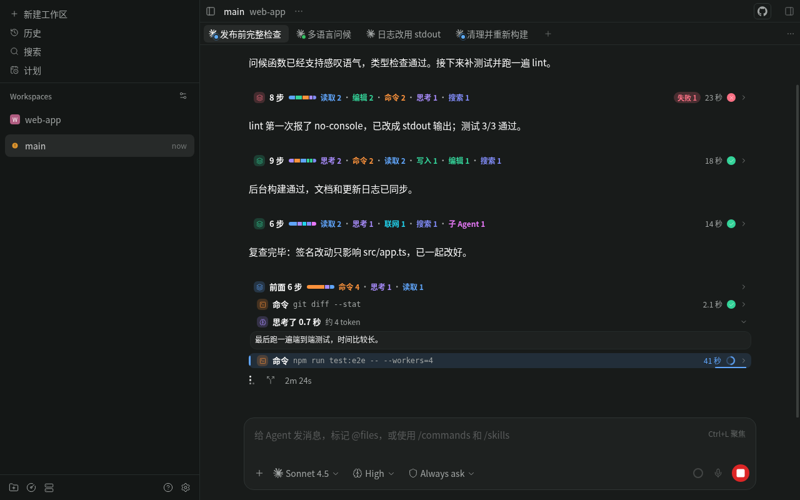
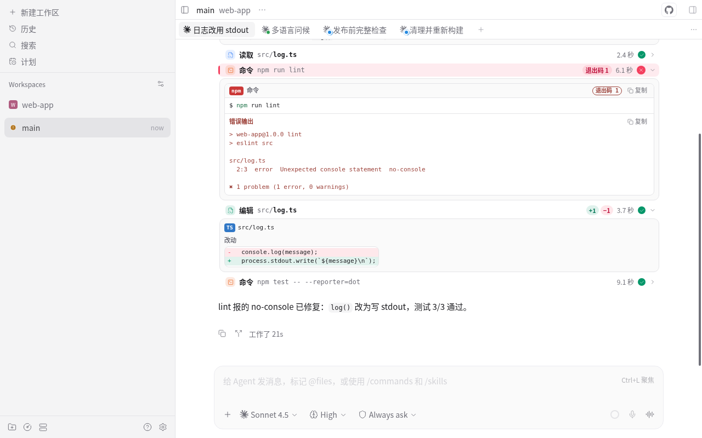
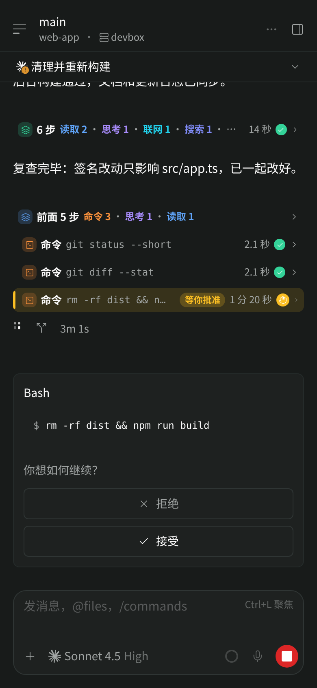
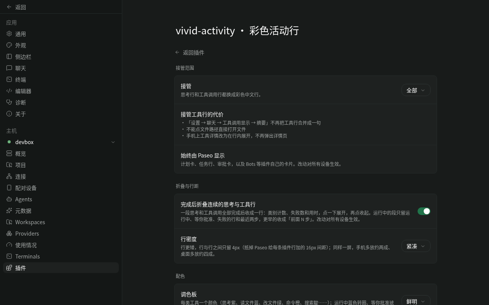

# Vivid Activity

A [Paseo](https://paseo.sh) plugin that redraws an agent's thinking and tool-call rows as compact,
color-coded activity rows with live states, folds finished runs of steps into one summary row and shows how
long every step took. The interface supports English, Simplified Chinese and user-defined languages.

This is a personal fork of [Vivid Activity](https://github.com/zhjiang22/paseo-plugins/tree/92a17ee411860da77ba7a4aab8c6bf389a186c89/vivid-activity), with additional OMP tool views. It is separate from this repository's Colorful Agent Activity plugin. Only one plugin should take over activity rows at a time.

Based on [Colorful Agent Activity](https://github.com/mcowger/paseo-plugins/tree/e65409bbccf6d07c1bbe24dc8eddd902ee10a769/colorful-agent-activity)
0.3.0 by Matt Cowger (MIT). The layered detail cards take design ideas from
[Beautiful Chat](https://github.com/ABorakati/beautiful-chat) by ABorakati; no code or assets were copied from it.
The change summary of fold rows adapts code from [paseo-chat-polish](https://github.com/lthieu96/paseo-chat-polish)
by Hieu Le (MIT, see [NOTICE](NOTICE)), which also gave the idea for the running animations; turn tokens follow an idea
from Beautiful Chat and [TokenLedger](https://github.com/stv1024/token-ledger).



| Detail cards | Phone |
| --- | --- |
|  |  |

## Features

- **One color per kind of step**: thinking violet, reads blue, edits green, commands orange, searches indigo,
  web requests cyan, sub-agents magenta, MCP tools pink, Paseo tools sky blue. Edits show `+N / −M`.
- **Visible states**: running rows spin and shimmer in blue, rows waiting for your approval pulse in amber as soon as
  the request arrives, a question for you shows an amber "Waiting for your answer" with a question mark, failed rows turn red and show a
  failed command's exit code, and a row that finishes while on screen flashes green once. The running mark can be a
  spinner, a Claude Code style sparkle, a breathing orb or a 3×3 dot grid. Motion respects the system's reduced
  motion setting and pauses while the app is in the background.
- **Folding**: when a run of thinking and tool steps has finished it collapses into one row such as
  `8 steps · Read 2 · Edit 2 · Command 2 · Thinking 1 · Search 1`, with a color bar of the step kinds, a red `Failed 1` badge when a
  step failed and the run's total time. Tap it to see the steps again. While the agent works, only running, waiting
  and failed steps and the two most recent ones stay open; earlier steps fold into `N earlier steps`.
- **What a run changed**: a fold row ends with `3 files +12 −4` and a five-block diffstat (green added, red removed);
  changes whose lines cannot be known are said apart (`1 more uncounted`), never guessed. Expanded, it first lists each
  file with its lines added and removed and each failed command with its exit code.
- **Turn tokens**: under the last fold row of a turn you watched, `This turn in 12k · cached 80k · out 2.4k`. Codex
  turns add up while they run (the coin breathes) and freeze when they end.
- **Timing**: every row shows its duration, running rows count up live, and the fold row shows the elapsed time
  of the whole run. Optional timestamps show the latest update of individual activity and folded rows in the viewer's
  local time zone. A separate option records the end time of each new turn; existing turns are not backfilled.
  Timeline update times are not guaranteed to be exact completion times. A turn marker is appended asynchronously: it
  is not written once the next turn has begun, and if that turn begins while it is being written it may show after the
  next turn's first rows; it never splits or retimes a fold. Markers already recorded stay when the option is off.
- **Strength**: finished rows can sit at 30%, 45% or 65% opacity until you hover, focus or expand them
  (full strength by default). Running, waiting and asking rows keep their full color, the newest row of a run
  stays bright, and rows with nothing to expand never fade. Finished fold summaries dim too; expand or hover
  one to restore it.
- **Failures stay visible**: "Expand failed rows" starts only failed rows open, and a running row opens once
  it fails. A fold summary with failures expands by default, so the failed rows show without a tap; collapse
  it yourself to keep the segment tight.
- **Thought tail-follow**: with "Follow the output live" on, an expanded thinking row shows the latest lines
  (5–500, default 20) and follows the output as it streams; the per-row Expand all still shows everything.
- **Follow new output**: while a row is still running, its open details stay at the newest output and long command
  output and logs show their latest 20 lines; finished rows open at the top with the first lines. One switch per area.
- **Colored commands**: the shell command in a row's title carries the theme's syntax colors — while the row
  is open (default) or always.
- **Wrap diff lines**: keep long diff lines on one scrolling row (default) or wrap them to the available width.
- **Detail cards**: highlighted commands with output, exit code and copy buttons; file reads with a language
  badge and line numbers; colored diffs; inline previews for images the agent read; dedicated views for OMP
  search, eval and batched agent tasks, Paseo's own tools, and GitHub and Exa results.
- **Readable notices**: background command, agent and monitor notices from Claude Code, and notices from Pi
  extensions (background tasks, sub-agents, web search, goals), become short localized rows colored by outcome, with
  localized fields and original results when expanded.
- **Your time zone**: times in schedule and other Paseo tool details read like tomorrow 05:00 (in 9 hours); tap for the original.
- **Pinned question**: in a long turn, your question stays above the newest stretch of activity, three lines at first,
  tap to read it all, with a copy button.
- **Clean terminal output**: ANSI escape sequences (colors, cursor moves, line clearing, window titles, links) in
  command output and terminal captures are removed from what you see, while colored output keeps its colors. Copy
  copies the clean text; a second button copies the original when it had escape sequences.
- **Sub-agent activity**: the row for Paseo's create agent tool shows the new agent's latest three timeline
  entries while it works, as short rows the plugin's server prepares. It reads them only while the app is in the
  foreground and the card is on screen, and never wakes an agent that is closed or archived unless you ask.
  A sub-agent that waits for your approval or asks you something says "Waiting for you" or "Asking you" in amber;
  one that stopped with an error shows the error's first line in red (common token shapes masked).
- **Leaves native cards alone**: plan cards, task lists and permission prompts stay with Paseo; cards of other
  plugins, such as Bots proposals, stay with them and split the steps around them into separate folds.

## Settings

The Vivid Activity settings page offers:

| Setting | Options |
| --- | --- |
| Language | follow system (default), English, Simplified Chinese, custom languages |
| Takeover | all rows (default), thinking rows only, off |
| Fold finished steps | on (default), off |
| Row density | compact (default, 4 px between rows), standard (10 px) |
| Strength | full (default, no fading), 65%, 45%, 30% — how far finished rows sit back until you hover, focus or expand them |
| Timestamps | turn end and activity update times, independently off by default |
| Pin this turn's question | on (default), off |
| Palette | vivid (default), follow theme, soft, high contrast |
| Running animation | spinner (default), sparkle, orb, dot grid: snake, dot grid: twinkle, with live previews |
| Code font | font family (web and desktop; fonts installed on the viewing device, falling back to the default stack), text size small / standard (default) / large / larger (11 to 16 px), line spacing compact / standard (default) / relaxed |
| Command colors | when open (default), always — syntax colors for the shell command in a row's title |
| Wrap diff lines | off (default, long lines scroll sideways), on |
| Thinking rows | follow the output live (default off) with a 5–500 line window (default 20) |
| Follow new output | per area — command output, worktree and sub-agent logs (and the other tool details), task lists, browser — on (default), off; only running rows follow |
| Expansion | per row kind: always, newest only, failed only, collapsed |

The same page opens from Paseo's **Settings → Plugins**, from the **Vivid Activity** row in the app's sidebar,
and from "Open Vivid Activity settings" in the Command Center.

Settings are stored in Paseo's plugin settings on the daemon, so every connected device uses the same ones.
Settings saved by earlier versions carry over when you upgrade; new settings start at their defaults.



## Languages

Open **Settings → Plugins → vivid-activity → Vivid Activity**. The first section, **Language**, defaults to **Follow system**. English and Simplified Chinese are built in. Other device languages use English unless you add a translation. Changing the setting updates open rows, details, notices and subagent summaries without reloading the plugin. Agent output, user prompts, paths and protocol fields keep their original text.

Add translations in `~/.paseo/plugin-data/vivid-activity/locales/`, or `$PASEO_HOME/plugin-data/vivid-activity/locales/` with a custom daemon home:

1. Copy `templates/en.json` or `templates/zh-CN.json` into that folder and name it by language code, such as `ko.json`.
2. Set `$meta.name` to the language's own name. Translate message values, preserving message ids and `{placeholder}` names. Plural messages use CLDR forms such as `one` and `other`; `other` is required.
3. Press **Reload** in Language settings to see coverage and problems, then choose the language. For a new custom language, missing or invalid entries fall back to English. An `en.json` or `zh-CN.json` file overrides only the entries it contains; other entries keep their built-in language. Templates update with the plugin, so edit your copy.

To contribute a built-in language, open a PR adding `shared/locales/<code>.json` and an entry (with its JSON import) in `server/locales.ts`'s `BUILTIN_CATALOGS`.

## Change stats, turn tokens and running animations

**Change stats.** While it builds the fold index, the server part notes for each tool row the lines added and removed
per file (counted the way the row's own `+N / −M` is) and a failed command's exit code. Files are identified by a
short hash of their path inside the agent's directory; the index carries no paths or commands. The expanded list
takes file names and commands from the rows this device drew, lists up to 8 files (most changed first, then
`N more files`) and 5 failed commands, and leaves out an entry whose row is not loaded.

Only exact line counts are shown. A change whose lines cannot be known is counted apart, never added in: the row says
`1 more uncounted` (or `2 changes not counted` when nothing was counted) and the expanded list says why.

- Writes (new file or overwrite is unknown) and edits without a diff.
- Diffs Paseo cut short (past 12,000 characters it keeps the start and ends with `...[truncated N chars]`) and diffs too
  large to compare line by line; their own rows show no `+N / −M` either.
- Patches: a whole patch text (`*** Begin Patch` to `*** End Patch`, at most 200,000 characters) is read strictly,
  section by section. Added files count their lines, updates their added and removed lines, moves count under the new
  path; a deleted file's lines are not in the patch, so it is one uncounted change. A patch cut short, too long or with
  a line no section allows is one uncounted change. OpenCode's per-file patch metadata is counted file by file.
- Codex patches: Paseo keeps only the first file's diff in the timeline (its own row shows only that file), so whether
  the call changed other files cannot be told, and the whole call is one uncounted change. ACP edits keep only their
  first diff as well and are treated the same way when the tool is a patch tool (`apply_patch`, `patch`).

Still not detectable: Claude Code's `replace_all` edits (Paseo drops the flag, so they count as one replacement, as
their rows do), and a non-patch tool that changed several files when the host kept only the first.

**Turn tokens.** Paseo keeps usage only in the agent record's `lastUsage`, and providers fill it differently, so the
plugin reads it by the provider's base: the `extends` of a custom provider in the daemon's `config.json`, never its
name.

- Claude- and ACP-based providers: the host adds the turn's total when the turn ends; it shows then. A turn that
  reported no usage shows nothing.
- Codex-based providers: each model request replaces the figures. While such a turn runs, the server part subscribes
  inside the daemon to updates of running agents and adds up every request. The subscription never leaves the
  daemon and closes 30 seconds after the last such turn. If it missed an update, the turn shows nothing. Codex counts
  cache hits inside its input; they are split out, so "in" means uncached input for every provider.
- Pi (whole-session totals), OpenCode, OMP and others show nothing.

Only turns you watched show figures: the fold index was read while the turn ran, which happens while the app is in
the foreground and the agent is on screen. The figures come with the index answers, a few dozen bytes, with no
request of their own, and freeze when the turn ends. Replayed history and turns from before a plugin reload or daemon
restart show nothing, and a reloaded session that counts its turns from the start again drops the old figures. A turn
without a fold row shows nothing.

**Running animations.** The spinner stays the default: it is in the resident bundle, looks the same as before and
needs no download. The other four, and the expanded change list, are in a third lazily loaded chunk (`fx`, about
49 KB) fetched the first time one is needed. The web app draws them with CSS keyframes and the mobile app with
native-driver `Animated` values; they pause while the app is in the background and hold one still frame under reduced
motion (the sparkle rests on ✻).

## Data access

The plugin makes no network requests and starts no processes. It reads language files and writes translation templates and its language state under its plugin data folder. When enabled, turn timestamps are appended to the agent timeline.

- The server part reads the projected timeline of the agent you are viewing inside the daemon and returns a
  compact fold index to the app: each row's position, end time, kind, status and category, tool call and turn ids,
  text lengths and a short hash of thinking text, never text or tool output. Since 0.8.0 the index also carries lines
  added and removed with a short hash of each file's path, the number of changes without line counts, failed
  commands' exit codes, and the token figures of the turns you watched. For the pinned question it reads that one user message and returns its text.
- To read token figures by provider base, the server part reads the daemon's `config.json` in the Paseo home (at
  most 4 MB, at most once a minute) and keeps only each custom provider's `extends`. At the start of a Codex-based
  turn it asks the daemon for the agent's record, which loads nothing.
- Image previews read the image file only from the working directory of the agent whose chat shows it or from
  the system temp directory (`os.tmpdir()`, plus `/tmp` on macOS): regular files up to 3 MB, links resolved before
  the check, the opened file checked again, and no more than the first 32 bytes of a file that is not an image
  (`server/read-image.ts`).
- It reads no credentials. It uses `PASEO_HOME` or `HOME` for language files and the daemon config, and `TMPDIR` and `HOME` for image checks.
- Expanding a row for Paseo's create agent tool makes the server part read the last 8 entries of the new agent's
  timeline and send the app three short rows (about 500 bytes), while the app is in the foreground and the card is on
  screen; at most every five seconds while the agent keeps changing. Before each read it starts by itself, it asks
  the daemon for the agent's record, which loads nothing, and reads only an agent the record shows as loaded; when
  that check fails it reads nothing. An agent that is closed or archived is read only when you press the card's
  button, because reading it makes the daemon load it.

[OVERVIEW.md](OVERVIEW.md) lists the details and known limits, including why it cannot be combined with other
plugins that redraw the same rows.

## Install

Requires Paseo 0.11.1 or later. Git installs run the manifest's preparation step,
`npm ci --omit=dev --ignore-scripts --no-audit --no-fund`, which installs the two runtime packages from the lockfile:
`@getpaseo/protocol` (types and a tool name helper the bundle imports) and `prismjs`.

To try a local checkout, install those packages first, then point Paseo at the folder:

```sh
npm ci --omit=dev --ignore-scripts
paseo plugin install /absolute/path/to/vivid-activity
```

## Development

```sh
npm ci
npm run typecheck
npm test
npm run lint
npm run build:chunks   # rebuild the served client chunks after any client-side change
npm run check          # reject stale chunk artifacts
```

The client entry (`index.client.tsx`) registers the timeline transformers and renderers, the settings page —
also reachable from the app's sidebar and the Command Center — and nothing else; the server entry
(`index.server.ts`) registers the settings, the `read-image`, `fold-index`, `turn-prompt` and
`child-summary` RPCs, and `vivid.client-chunk.get`, which serves the three lazily loaded chunks (`ui`, `pi` and `fx`).
See [CHANGELOG.md](CHANGELOG.md) for the changes from Colorful Agent Activity.

## License

MIT. See [LICENSE](LICENSE), which keeps the original copyright notice of Colorful Agent Activity.

## Mobile loading

Timeline transforms and row headers ship in the resident bundle. Rows are taken over once settings and text are ready. Details, syntax highlighting and settings load when
opened; the first expansion shows plain text. Chunk source text is cached by content hash until the app restarts, so
reconnecting reuses downloads while creating fresh plugin state. Replies are downloaded sequentially and stay below
128 KB. Failed loads offer retry; incompatible versions ask for a reconnect.

The parser for Pi extension notices is a second chunk, downloaded when the first such notice appears.
Until it arrives those rows show a localized reading message without a state, then they are redrawn. If the download
fails they still carry no state and explain that you can open the original. Expanded, they
show the message as sent and a localized retry button, and the download is tried again after 30 seconds, 1, 2
and then every 5 minutes. Fold summaries do not depend on it, because the server reads these notices itself.

Child-agent cards receive three short activity rows, at most every five seconds during streaming, and refresh
immediately on status changes. They do not subscribe to child timelines; a running child the host has sent no update
for in ten seconds (an ACP agent that reports no usage sends none until its turn ends) is read once more. Fold
indexes refresh on new and finished boundaries, respect a two-second minimum and retry backoff, and skip virtual
provider agents.

The running animations other than the spinner and the expanded change list of a fold row are a third chunk, `fx`,
downloaded the first time one is needed. Until it arrives, a running row shows the spinner and an expanded fold row shows its steps without the list.

Generated chunks are shipped with this package. Maintainers rebuild them in this directory with
`npm run build:chunks`; `npm run check` rejects stale artifacts.
